# Smart Compiler Infrastructure

This project introduces an agentic approach for high-level and multi-purpose compilers.

This release connects that workflow to [Cetus](https://github.com/PAROT-Udel/The-Cetus-Project) optimization capabilities for C programs: parallel-aware tiling (PAW Tiling) to improve cache locality while preserving data dependencies and supporting parallel execution; improved loop interchange that checks legality and uses reuse analysis to choose loop order, including for symbolic loop bounds; and subscripted-subscript analysis for supported indirect accesses such as A[B[i]], helping identify additional parallelization opportunities.


## License

[](https://opensource.org/license/BSD-3-clause)

## References

- To deploy a LLM using ollama first we need to install Ollama by following 
its [Official Documentation](https://ollama.com)

## Acknowledgements

- National Science Foundation (NSF) funded AI institute for Intelligent Cyberinfrastructure with Computational Learning in the Environment (ICICLE) (OAC 2112606)

---

# Explanation

The core vision is to integrate a suite of expert-level compiler tools, enabling seamless, intelligent code analysis, optimization, and profiling for diverse programming languages.

## Smart Compiler Architectural Diagram

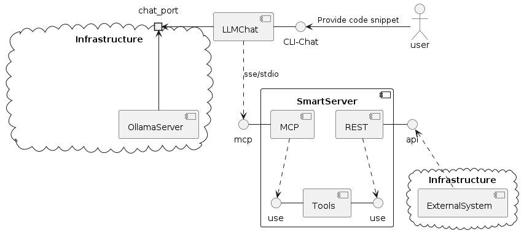

## IMT Integration

Details about the Smart Compiler as an Integration with the IMT (ICICLE Middleware and Tools) project can be found on the following diagramas:
### **Diagrams**:  
- [Diagram 1](https://drive.google.com/file/d/1S5gRxw_vizR1XnmbiZnAH1yZnkB8Ep0_/view?usp=drive_link)  
- [Diagram 2](https://drive.google.com/file/d/1tgCcINlzBUe6A1PCNX6R_ftAnb9WidcA/view?usp=sharing)


---


# How-To Guides

## Install the project
For dependency management and installation, this project uses ```uv```.
See [Astral Documentation](https://docs.astral.sh/uv) for installing the uv package manager.


## Project dependencies

### Create a virtual environment

In order to make a safe installation on the system, it is suggested to create a virtual envionment and install all the packages in this VE.
Let's create a virtual environment called SmartCompiler.
`python -m venv SmartCompiler`

Now, let's initiallize the virtual environment.
`source SmartCompiler/bin/activate`


### Packages
After installing **uv** run: ```uv sync``` for syncing project dependencies. 


If you do not want to use `uv` for dependencies maangement, you can install dependencies from the **requirements.txt** file. 
You can run `pip install -r requirements.txt` 

### Ollama
To deploy a LLM using ollama first we need to install Ollama by following 
its [Official Documentation](https://ollama.com).

Once Ollama is installed deploy the Ollama server (if it was not deployed by the installation).


### Quick Ollama deploy
1. Serve the Ollama server: ```ollama serve``` (if it is not already deployed).
2. Create LLM model using the SmartCompiler Modelfile: ```ollama create llama3.1-smart-compiler -f ollama-smart-compiler-Modelfile```.
3. Run the created LLM: ```ollama run llama3.1-smart-compiler:latest```.
4. If it opens a chat after running the LLM, just type ```/bye``` to close that chat.

#### Useful notes
##### To extract a Modelfile with ollama

```ollama show --modelfile llama3.1 > Modelfile```

###### To create from Modelfile with ollama

```ollama create llama3.1-tool -f Modelfile```


#### Setting up Environment Variables

Run the client and server from the SMART-COMPILER project root. Both entry points load a root-level `.env` file automatically with `python-dotenv`, so you do not need to source it manually.

On first setup, copy the checked-in client template to a private root-level `.env` file:

```bash
cp envs/.client.example.env .env
```

If `.env` already exists, edit it instead of overwriting it. Set `LLM_MODEL` and `LLM_HOST` for the provider you want the client to use.

**Local Ollama** — no API key is needed:

```dotenv
LLM_MODEL=llama3.1-smart-compiler:latest
LLM_HOST=http://localhost:11434
```

**OpenAI API** — use a model that supports tool calling:

```dotenv
LLM_MODEL=gpt-6-astra
LLM_HOST=https://api.openai.com/v1
# Replace with your key in this private .env file; never commit a real key.
OPENAI_API_KEY=your-openai-api-key
```

You can also provide `OPENAI_API_KEY` through your shell. The root `.env` is ignored by Git; keep real keys out of tracked example files. The OpenAI client uses the Responses API for `api.openai.com`.

These client settings apply with either provider:

```dotenv
LOG_LEVEL=INFO
MCP_SERVER_URL=http://localhost:8000/sse
ALLOWED_PATHS="/path/to/SMART-COMPILER/examples"
```

Replace `ALLOWED_PATHS` with the source directories the client may access. Server-side profiling still uses the Ollama settings `OLLAMA_MODEL` and `OLLAMA_HOST`; see `envs/.server.example.env` for the Cetus and server configuration.

## Option 1:  Running the project without Docker
For running the project, once all dependencies and configurations are set, run the following command:

### Cetus compiler

SMART uses Cetus as a separate compiler. Get it from the [Cetus project](https://github.com/PAROT-Udel/The-Cetus-Project). To clone and build it, run:

```bash
git clone https://github.com/PAROT-Udel/The-Cetus-Project.git
cd The-Cetus-Project
./build.sh bin
```

If you download an archive instead, extract it and run `./build.sh bin` from the extracted project root (the directory containing `build.sh`).

The build creates the Cetus launcher at `bin/cetus`. Set `CETUS` to the absolute path of that executable, for example `/path/to/The-Cetus-Project/bin/cetus`. Keep the checkout intact because the launcher uses supporting files from the same Cetus directory.

### SERVER (without Docker)

Before starting SMART, set `CETUS` to the absolute path of the `bin/cetus` executable built above, and set `CETUS_PROFILES_FILE` to the SMART-COMPILER profile file. Both variables are required for optimization requests; `CETUS_TIMEOUT_SECONDS` is optional and defaults to 300 seconds.

```bash
export CETUS="/path/to/The-Cetus-Project/bin/cetus"
export CETUS_PROFILES_FILE="/path/to/SMART-COMPILER/config/profiles.json"
export CETUS_TIMEOUT_SECONDS=300

# Confirm both configured paths exist and are usable.
test -x "$CETUS" || { echo "Cetus is missing or not executable: $CETUS"; exit 1; }
test -r "$CETUS_PROFILES_FILE" || { echo "Profiles file is missing or unreadable: $CETUS_PROFILES_FILE"; exit 1; }

python src/run_server.py
```

Replace the example paths with paths on the machine running SMART. Do not rely on a checked-in Cetus location. Docker Compose has its own host-path setup below.

### CLIENT
Run the client.

Note: This client is a simple version that extends Llama model for using tools. Since the client is not robust enough, we encourage you using other more robust tools such as Claude desktop, Copilot or ChatGPT with MCP tools.

Smart compiler client is a PoC.

```bash
python src/run_client.py

```

The client displays `You:` and accepts a natural-language request directly. It does not prompt separately for a project folder or file name. When asking it to optimize a file, include that C file's absolute path and the optimization profile. Replace `/path/to/SMART-COMPILER` in these examples with the location of your checkout.

Examples:

- **Parallelization:** `Please optimize the C file at /path/to/SMART-COMPILER/Testing_Examples/01_vector_scale.c using the parallel profile.`
- **Tiling:** `Please optimize the C file at /path/to/SMART-COMPILER/Testing_Examples/03_matrix_multiply.c using the paw_tiling_nt profile.`
- **Loop interchange:** `Please optimize the C file at /path/to/SMART-COMPILER/Testing_Examples/05_loop_interchange.c using the loop_interchange profile.`

To profile a code snippet, include its C source in the request, for example:

```text
Profile this C program and summarize its performance:
<paste C source here>
```


## Option 2: Cetus optimizer runtime (Docker Compose)

The server image includes a Java runtime for Cetus. Before starting Compose, set the host paths to the built Cetus checkout and SMART-COMPILER profile JSON. The checkout is mounted read-only at the absolute path embedded in its generated `bin/cetus` launcher; set `CETUS_CONTAINER_DIR` to that path. The profile file is mounted read-only into the server container. These values are supplied at runtime rather than baked into the image.

```bash
export CETUS_HOST_DIR="/path/on/host/The-Cetus-Project"
export CETUS_CONTAINER_DIR="/path/embedded/The-Cetus-Project"
export CETUS="$CETUS_CONTAINER_DIR/bin/cetus"
export CETUS_PROFILES_HOST_FILE="/path/on/host/SMART-COMPILER/config/profiles.json"
docker compose up -d --build
```

Replace the example paths with locations on your machine. `CETUS_CONTAINER_DIR` must match the checkout path embedded in the Cetus launcher. These shell exports do not modify an existing `.env` file or other user configuration. Compose passes `CETUS` and mounts the profile file as `CETUS_PROFILES_FILE` inside the server container.

The server keeps uploaded inputs, transformed outputs, and task records in named volumes mounted at `/app/files` and `/app/db`, so they survive container recreation.

## Invoking the Cetus optimizer

The optimizer accepts C source and applies one named profile from `SMART-COMPILER/config/profiles.json`. Available profiles are `parallel`, `paw_tiling_nt`, `paw_tiling_lrw`, `paw_tiling_fixed32`, `reuse_analysis`, and `loop_interchange`.

### MCP

Call the `optimize_code_snippet` tool with the C source and a profile. For example:

```json
{
  "code_snippet": "#include <stdio.h>\nint main(void) { return 0; }\n",
  "optimization_profile": "parallel"
}
```

The tool returns the transformed C source as text.

### REST API

Upload a `.c` file to `POST /tasks` as multipart form data. For example:

```bash
curl --fail -X POST http://localhost:8000/tasks \
  -F "task_type=optimize" \
  -F "language=c" \
  -F "optimization_profile=paw_tiling_nt" \
  -F "file=@input.c"
```

The response includes `task_id` and `task_status`. Poll `GET /tasks/{id}` until the status is `completed` or `failed`. On success, use `task_result.file_path` to download the transformed source:

```bash
FILE_PATH="<copy task_result.file_path from the response>"
curl --fail --get http://localhost:8000/files/download \
  --data-urlencode "file_path=${FILE_PATH}" \
  --output optimized.c
```

If the task fails, inspect `task_result.error` in the response.

`Regression-Test` checks transformed code against expected output and builds/runs benchmark programs for correctness. It does not measure execution speed or select the fastest profile; compare benchmark timings separately when evaluating performance.

## Option A: Running from a single container
### Building image.
Build the smart compiler server, client and Ollama by running the script:
```bash
docker compose up -d --build
```

### Start an interactive sesion.
```bash
docker attach smart_client
```

Start playing with the Smart Compiler!

## IMPORTANT NOTE: 

In case thwere is an error that says : "llama3.1-smart-compiler:latest" not found"
Type the following commands:
```bash
docker compose exec ollama sh -lc 'ollama pull llama3.1'
docker compose exec ollama sh -lc 'ollama create llama3.1-smart-compiler -f /workspace/ollama-smart-compiler-Modelfile'
```
And then restart the client:

```bash
docker compose restart client
```

and 

### Start an interactive sesion.
```bash
docker attach smart_client
```

Start playing with the Smart Compiler!


## Option B: Running from a two different containers

### Building images.

Build the smart compiler server and client by running the scripts:

```bash
docker build -f Dockerfile -t smart_server . #For SERVER
docker build -f Client_dockerfile -t smart_client . #For Client
```

**Note:** By default, the dockerfiles are configured for localhost deploy. If you are planning to deploy it in a distributed architecture, you need to make sure on setting up the proper env variables inside the dockerfiles.

### Running containers
For running the smart server you can run the following script.
```bash
docker run -d --name smart_server -p 8000:8000 smart_server #Server
docker run -it --name smart_client -p 8001:8001 smart_client #Client. Remember -it

```


# Tutorials
The Smart Compiler leverages AI models alongside traditional compiler techniques to boost the performance and scalability of C and Python programs. Through intelligent profiling and optimization strategies, it identifies and applies enhancements to improve code efficiency.

## Option 3: Getting Started as an MCP Tool with COpilot or Cursor or Claude Desktop

This section guides you through setting up and using the Smart Compiler as an MCP (Model Context Protocol) tool alongside Cursor or Claude Desktop for code profiling and optimization.

### Copilot
(In case the env varibales are not enabled and the client and the server are not deployed)
First, we need to enable the environment variables for both, the Server and the client. See previous sections .

Now, we must deploy the server

```bash
python src/run_server.py

```

Once the servwer is deployed, let's deploy the Client

```bash
python src/run_client.py

```

Once the client and the server are deployed, we must go to VScode and type "control + shift + P " and search for " MCP: add Server"

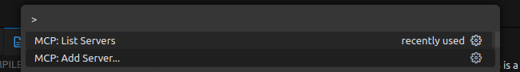

Then we choose HTTP:

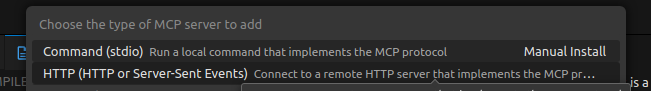

and then we add our Smart Compiler CLient deployed address: 

```bash
http://localhost:8000/sse
```

Now, we open a chat in COpilot and we set "Agent" instead of "Ask"

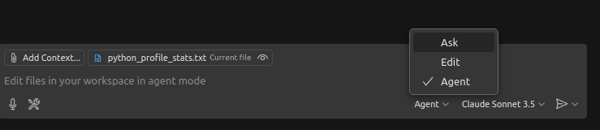

Now, we can start our first use case: 

Create a python code snippet that do some matrix multiplication and profile it

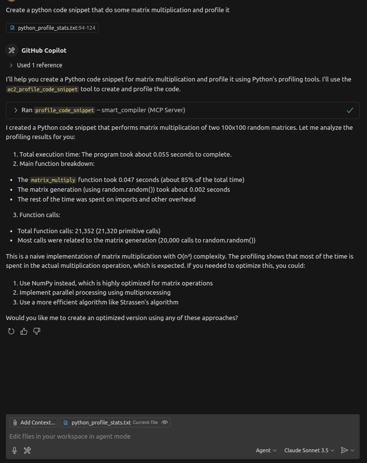

The code snippet and profiling information will be stored in the tmp/ directory inside your SMART-COMPILER checkout.


### CORSE AND CLAUDE CONFIGURATION

### Server Setup
Configure the required environment variables in a local `.env` file, such as `.local.server.env`, to enable the MCP server.

```bash
#.local.server.env
LOG_LEVEL=INFO
OLLAMA_MODEL=llama3.1:latest
OLLAMA_HOST=http://localhost:11434  # Adjust to your model's hosting address
MCP_SERVER_HOST=0.0.0.0 #used for both, rest api and mcp servers
MCP_SERVER_PORT=8000 #for mcp and rest
MCP_SERVER_TRANSPORT=stdio
ENABLE_REST_API=false
ALLOWED_PATHS="/path/to/smart-compiler/examples"  # Specify the accessible directory
```

### Configuring Cursor
For Cursor, update the configuration to connect to the MCP server.

```json
{
  "mcpServers": {
    "smart_compiler": {
      "url": "http://localhost:8000/sse",
      "env": {}
    }
  }
}
```

### Configuring Claude Desktop
For Claude Desktop, configure the command and environment settings to run the MCP server.

```json
{
  "mcpServers": {
    "smart_compiler": {
      "command": "uv",
      "args": [
        "--directory",
        "/path/to/smart-compiler",
        "run",
        "src/run_server.py"
      ],
      "env": {
        "UV_PROJECT_ENVIRONMENT": "/path/to/smart-compiler",
        "UV_ENV_FILE": "/path/to/smart-compiler/envs/.local.mcp_server.env"
      }
    }
  }
}
```

### Verifying Server Deployment
Ensure the MCP server is running correctly by checking its connectivity.Refer to the example profiling request screenshot in the documentation:
<div>
    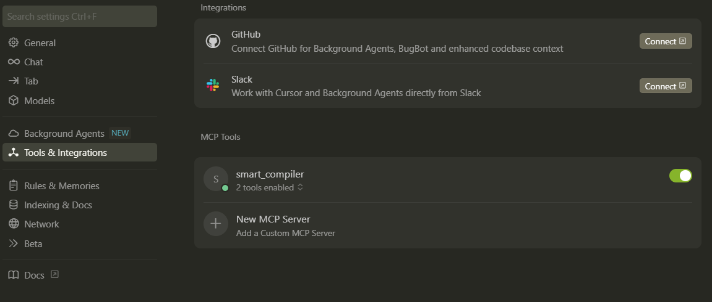
</div>

### Generating Code Snippets
Using Cursor to generate a code snippet for analysis.  
<br>
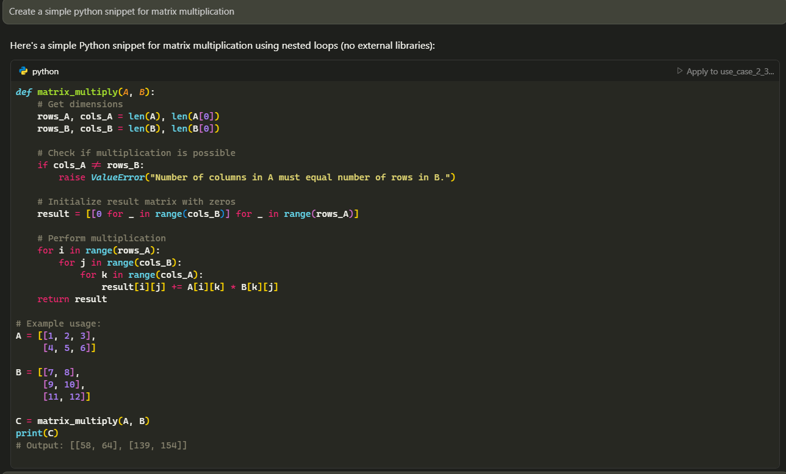

### Profiling Code
Request the Smart Compiler to profile your code via the MCP client. An example of tool usage is shown in the documentation.

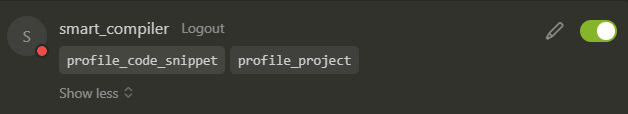

### Advanced Usage
Experiment with larger datasets and more complex interactions, as demonstrated in the documentation screenshots:

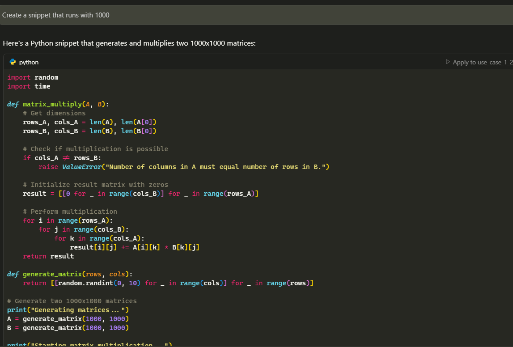
<br>
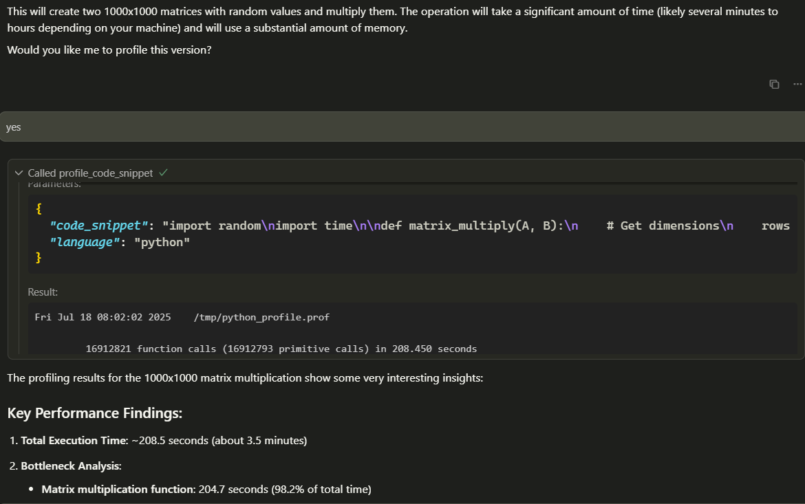
<br>
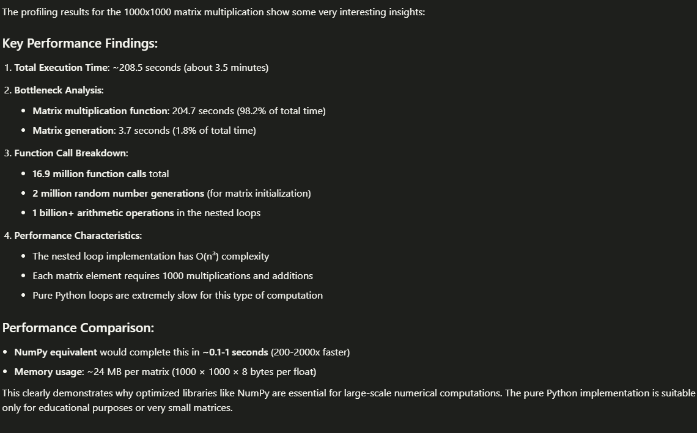
<br>

For a complete example, review the chat history in [Cursor + SmartCompiler example](docs/cursor_simple_python_snippet_for_matrix.md)

**Summary**: This section covers setting up the Smart Compiler as an MCP tool, configuring environment variables, connecting with Cursor or Claude Desktop, verifying server deployment, generating code snippets, profiling code, and exploring advanced use cases with larger datasets.

## Using Smart Compiler as a REST Service

This section explains how to deploy the Smart Compiler as part of monitoring environment by enabling its REST API for compiler tasks.

### Environment Setup for REST API
Configure the environment variables in `local.server.env` and enable the REST API.

```bash
LOG_LEVEL=INFO
OLLAMA_MODEL=llama3.1:latest
OLLAMA_HOST=http://localhost:11434  # Adjust to your model's hosting address
MCP_SERVER_HOST=0.0.0.0 #used for mcp and rest servers
MCP_SERVER_PORT=8000
MCP_SERVER_TRANSPORT=stdio
ENABLE_REST_API=true  # Enable REST API
ALLOWED_PATHS="/path/to/smart-compiler/examples"  # Specify the accessible directory
```

### Accessing API Documentation
Once the server is deployed, access the API documentation at `http://localhost:8000/docs`. For Postman collections, refer to the Smart Compiler GitHub repository.

### Scheduling a Profiling Task - IMT integration
Schedule a profiling task to analyze a code snippet, such as the provided [example](examples/matrix-multiplication/main.py)

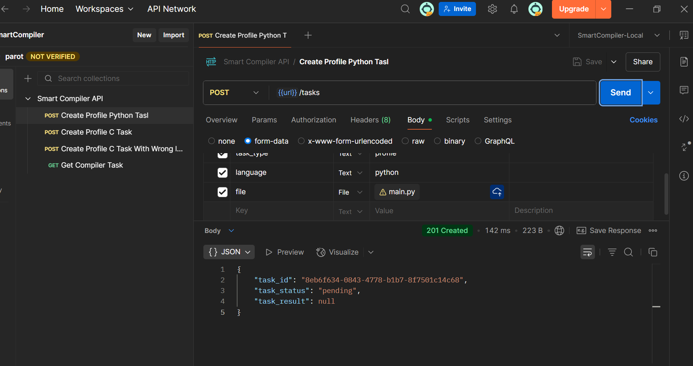

### Checking Task Status
Monitor the status of a scheduled profiling task, as shown in the screenshot.

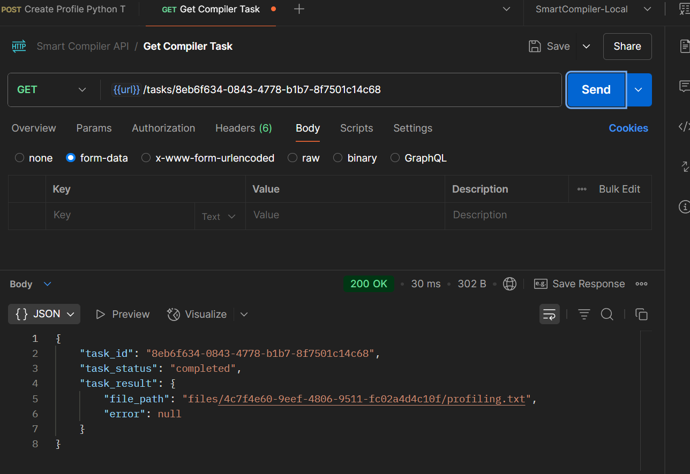

### Retrieving Profiling Results
Access profiling results via the API: 

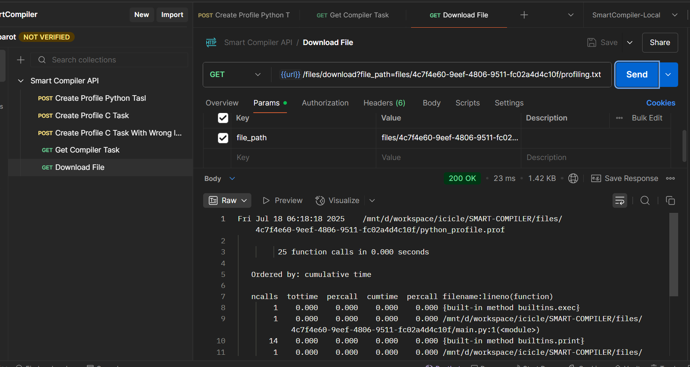

### Scheduling an Optimization Task
*Note*: Optimization task scheduling is currently in development and not yet available.


### Client Setup

Configure the client in the root `.env` as described in [Setting up Environment Variables](#setting-up-environment-variables). Start the MCP server first, then run the client from the SMART-COMPILER project root:

```bash
uv run python src/run_client.py
```

The client will ask what task to perform. For example:

- `Please optimize the C file at /path/to/SMART-COMPILER/examples/vector.c using the parallel profile.`
- `Please profile the C file at /path/to/SMART-COMPILER/examples/vector.c.`

Note: The client implemented in the SmartCompiler project is a PoC of a client. The “client” inside the SmartCompiler project is not a full production-ready client, but rather a minimal or experimental implementation. Its purpose is to demonstrate feasibility—showing that a client can connect, interact, and work with the SmartCompiler system. For more advanced uses, we recommend trying it out with platforms focused on MCP tools such as Cursor, Claude Desktop or Github Copilot as explain in previous sections.

--- 
